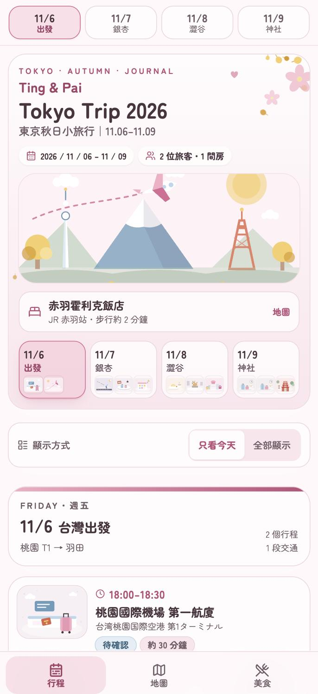

# Ting & Pai Tokyo Trip 2026 🌸

> 東京秋日小旅行｜2026 / 11 / 06 – 11 / 09｜2 位旅客・1 間房

一頁式、手機優先的「Soft Pink × 日系可愛手帳」互動行程網站。純前端、不需後端、不需任何 API Key，可直接免費部署到 GitHub Pages。

- **技術**：React 18 + TypeScript + Vite 5 + Tailwind CSS 3 + Lucide Icons
- **插畫**：28 張原創 SVG 插畫（`src/illustrations/`），沒有使用任何受版權保護的圖片或 Google Maps 截圖
- **地圖**：只使用 Google Maps 官方的 URL 參數（`https://www.google.com/maps/dir/?api=1&...`），不呼叫付費地圖 API
- **隱私**：勾選狀態、預約狀態與住宿資料都只存在瀏覽器的 `localStorage`，不會上傳任何資料



---

## 目錄

1. [快速開始](#快速開始)
2. [網站功能](#網站功能)
3. [粉色設計系統](#粉色設計系統)
4. [修改行程](#修改行程)
5. [修改住宿飯店](#修改住宿飯店)
6. [新增或修改插畫](#新增或修改插畫)
7. [部署到 GitHub Pages](#部署到-github-pages)
8. [已查證的交通路線](#已查證的交通路線)
9. [11/9 行李處理方案](#119-行李處理方案)
10. [已知限制與未查證資訊](#已知限制與未查證資訊)
11. [專案結構](#專案結構)

---

## 快速開始

需要 Node.js 18 以上（開發時使用 Node 26 / npm 11）。

```bash
npm install
```

```bash
npm run dev
```

```bash
npm run build
```

```bash
npm run preview
```

- `npm run dev`：開發伺服器，預設 http://localhost:5178
- `npm run build`：先跑 `tsc -b` 型別檢查，再輸出 production build 到 `dist/`。型別有錯就不會產出 `dist/`
- `npm run preview`：預覽 `dist/` 的建置結果

> ⚠️ 改過 `tailwind.config.js` 之後請重啟 `npm run dev`，Tailwind 的 JIT 快取不一定會自己更新新增的色票 class。

---

## 網站功能

底部三個分頁：**行程**、**地圖**、**美食**。

### 行程

- 置頂（手機黏在畫面上方）的四天日期切換：11/6 出發、11/7 銀杏、11/8 澀谷、11/9 神社
- 點日期平滑捲動，不重新載入頁面；「只看今天」／「全部顯示」兩種檢視
- 景點卡片：時間、中文名稱、日文原名、專屬插畫、簡介、地址、停留時間、參考價格、預約狀態、Google Maps、官方網站、訂位連結
- 每兩張景點卡片之間都有一張**交通卡片**：起點、終點、運具圖示與顏色、推薦路線、路線名稱、起終點與轉乘站、月台、預估搭乘／步行時間、票價、Google Maps 導航
- 預約狀態可切換：未預約／已預約／需候位／待確認；每個行程可勾選「已完成」
- 交通卡片可自行加備註或修改時間
- 頁尾有「住宿設定」與「已知限制與未查證資訊」

### 地圖

四天所有景點與交通整理成一份清單，每一列都是一個 Google Maps 連結（景點用地點搜尋，交通用路線導航）。

### 美食

這趟的 5 家餐廳集中一頁，含價位、訂位狀態、訂位連結與 Tabelog 搜尋。

### 手機體驗

- 底部固定導覽列，處理 iOS `env(safe-area-inset-bottom)`；頂部處理 `env(safe-area-inset-top)`（Dynamic Island）
- 所有可點擊元素至少 40–44px 高，正文 15–16px，輸入框 16px（避免 iOS Safari 自動放大）
- 375 / 390 / 402 / 440px 四種寬度都不會橫向捲動
- 支援「加入主畫面」（`manifest.webmanifest` + `apple-touch-icon.png`）
- 支援深色模式（右上角切換，淺色粉白為預設）
- 遵守 `prefers-reduced-motion`，關閉飄落銀杏葉與捲動動畫

---

## 粉色設計系統

所有顏色集中在 [`tailwind.config.js`](tailwind.config.js) 的 `theme.extend.colors`，要換配色只改這一處。

| Token | HEX | 用途 |
| --- | --- | --- |
| `cream` | `#FFF8FA` | 全站主背景（奶油粉白） |
| `card` | `#FFFCFD` | 卡片背景（柔和白粉） |
| `paper` | `#FBE5ED` | 次要粉色底（淡粉） |
| `line` | `#EFD6DF` | 卡片邊框（粉灰） |
| `sakura` | `#F4AFC4` | 主要品牌粉（櫻花粉） |
| `rose` | `#D96B94` | 玫瑰粉：邊框、選中底、圖示 |
| `roseDeep` | `#B94E77` | 按鈕填色與粉色小字 |
| `rosePress` | `#A34268` | 按鈕按住、粉底上的選中文字 |
| `ginkgo` / `ginkgoDeep` | `#F4D57E` / `#6E5208` | 銀杏黃強調色與其文字 |
| `sage` / `sageDeep` | `#B9CFBF` / `#4F6E5B` | 鼠尾草綠輔助色與其文字 |
| `sky` / `skyDeep` | `#BBD7EA` / `#3A6580` | Metro 淡藍與其文字 |
| `coral` | `#B04560` | 待確認／提醒 |
| `ink` / `inkSoft` | `#49343D` / `#6F5C66` | 主要文字（深莓棕）／次要文字（暖灰紫） |

**用色比例**：約 60% 粉白背景與卡片、25% 柔和粉、10% 玫瑰粉互動元件、5% 黃綠輔助色。

**對比度**：以 WCAG 2.1 AA（一般文字 4.5:1、大字 3:1）為準，用瀏覽器實測頁面上每一段文字（含半透明底色的合成結果），目前 **0 筆未達標**。

> 規格建議的玫瑰粉 `#D96B94` 當白字按鈕底只有 3.2:1，不符合 AA。因此做了兩個調整，並刻意保留在這裡說明：
> - 實心按鈕改用較深的 `roseDeep #B94E77`（白字 4.8:1），`#D96B94` 保留給邊框、選中底色與圖示
> - 次要按鈕（線上訂位）改成「粉底＋深粉字＋玫瑰粉描邊」，而不是實心玫瑰粉

**交通卡片**：外框與時間軸連接線統一是粉色系，卡片本身保留各運具的辨識色 —— 步行＝淡粉米白、JR＝鼠尾草綠、東京 Metro＝淡藍、計程車＝淡銀杏黃、Skyliner＝柔和藍紫、飛機＝淡天空藍。

**插畫**：底色與中性色往粉嫩移動，但**食物保留自然色**（蟹紅、鮭魚橘、檸檬黃）、**鳥居保留朱紅**、**銀杏保留金黃**。沒有刪掉任何一張原插畫。

---

## 修改行程

**所有行程資料都集中在 [`src/data/itinerary.ts`](src/data/itinerary.ts) 一個檔案。**

```ts
export const days: Day[] = [
  {
    id: 'd2',
    date: '11/7',
    short: '銀杏',          // 日期按鈕上的兩字主題
    // ...
    items: [
      {
        kind: 'place',       // 景點卡片
        id: 'd2-p6',
        time: '11:30–13:00',
        title: '立川 蟹最上',
        jp: '蟹最上 立川',
        illustration: 'crab', // 對應 src/illustrations/index.tsx 的註冊表
        desc: '螃蟹與壽司套餐……',
        address: '東京都立川市柴崎町 3-1-7 立川南口第2ビル 5F',
        stay: '約 90 分鐘',
        priceText: '……',
        reserve: 'none',      // none | booked | queue | tbc
        mapQuery: '立川 蟹最上',
        booking: 'https://...',
        official: 'https://...',
        tabelogQuery: '蟹最上 立川',  // 有填的才會出現在「美食」頁
        notes: ['……'],
      },
      {
        kind: 'transit',      // 交通卡片
        id: 'd2-t5',
        mode: 'walk',         // walk | jr | metro | taxi | skyliner | flight | terminal
        from: '立川 蟹最上',
        to: '昭和紀念公園 立川口',
        recommend: '步行',
        walkMin: '步行約 25–35 分鐘（估算）',
        travelmode: 'walking', // Google Maps 的 walking / transit / driving
        mapsFrom: '蟹最上 立川',
        mapsTo: '国営昭和記念公園 立川口',
        tbc: true,
        tbcReason: '原因寫在這裡',   // 會顯示在「路線細節」裡
      },
    ],
  },
];
```

| 欄位 | 說明 |
| --- | --- |
| `short` | 日期按鈕上的兩字主題 |
| `reserve` | `none` 未預約／`booked` 已預約／`queue` 需候位／`tbc` 待確認 |
| `tabelogQuery` | 有填的景點會被當成餐廳，出現在「美食」分頁 |
| `tbc` + `tbcReason` | 交通卡片顯示紅色「待確認」標籤與原因 |

旅伴名字、人數與副標在同一個檔案的 `meta`：

```ts
export const meta: TripMeta = {
  title: 'Tokyo Trip 2026',
  owners: 'Ting & Pai',
  fullTitle: 'Ting & Pai Tokyo Trip 2026',
  travelers: 2,
};
```

---

## 修改住宿飯店

目前住宿是 **赤羽霍利克飯店（Akabane Holic Hotel／赤羽ホリックホテル）**，〒115-0045 東京都北区赤羽 1 丁目 4-4，JR 赤羽站步行約 2 分鐘。

**A. 在網頁上改（不用動程式碼）**

「行程」分頁最下方的「🏨 住宿設定」→「修改住宿資料」。存在瀏覽器的 `localStorage`，首頁與所有引用住宿的交通卡片會立刻同步更新。

**B. 改預設值（讓每個人打開都看到）**

編輯 `src/data/itinerary.ts` 的 `defaultHotel`：

```ts
export const defaultHotel: Hotel = {
  name: '赤羽霍利克飯店',
  nameEn: 'Akabane Holic Hotel',
  nameJa: '赤羽ホリックホテル',
  address: '〒115-0045 東京都北区赤羽 1 丁目 4-4',
  nearestStation: 'JR 赤羽站',
  stationWalk: '步行約 2 分鐘',
  checkIn: '2026-11-06',
  checkOut: '2026-11-09',
  guests: 2,
  rooms: 1,
  note: '……',
};
```

行程資料裡的 `{{hotel}}`、`{{hotelAddress}}`、`{{hotelStation}}` 三個樣板變數會自動替換。

> ⚠️ **網站不會自動重新計算車程與票價。**
> 沒有可靠的即時交通資料來源，所以改完住宿後不會假裝已經重算過。
> 請點交通卡片的「開啟 Google Maps 導航」自行確認，再用「加備註／改時間」記下實際結果。

> 💡 住宿資料有版本控管（`SCHEMA_VERSION`）。改 `defaultHotel` 之後，把 `src/state/TripState.tsx` 的 `SCHEMA_VERSION` 加一，舊訪客的瀏覽器就會換成新飯店，但勾選與預約狀態都會保留。

---

## 新增或修改插畫

插畫都是原創 SVG React 元件，放在 `src/illustrations/`：

| 檔案 | 內容 |
| --- | --- |
| `base.tsx` | 共用畫框 `Frame`、色票 `C`、雲朵、月亮、銀杏葉等零件 |
| `travel.tsx` | 機場、飛機、計程車、飯店、早餐、退房、Skyliner、伴手禮、報到 |
| `food.tsx` | 螃蟹、壽司、牛舌、刺身、蟹鍋 |
| `city.tsx` | 八公、109、PARCO、中心街、MIYASHITA PARK、夜景、阿美橫丁 |
| `nature.tsx` | 和服、銀杏大道、鳥居、谷中小貓、上野公園 |
| `hero.tsx` | 首頁主視覺（富士山、東京鐵塔、晴空塔、小飛機） |
| `index.tsx` | 插畫註冊表 |

新增步驟：

1. 在上述任一檔案寫一個回傳 `<Frame>…</Frame>` 的元件（viewBox 固定 `0 0 120 90`）
2. 在 `src/data/types.ts` 的 `IllustrationKey` 加上新的 key
3. 在 `src/illustrations/index.tsx` 的 `illustrations` 註冊表加上對應
4. 在行程資料的 `illustration` 欄位使用它

TypeScript 會確保 key 與註冊表一一對應，漏掉會在 `npm run build` 時報錯。

---

## 部署到 GitHub Pages

這個專案已經設定好 `base: './'`（相對路徑），所以**同一份 `dist/` 可以放在網域根目錄或任何子路徑**，不會出現資源 404。

### 1. 建立 repository 並推上去

```bash
git remote add origin https://github.com/<你的帳號>/tokyo-trip-2026.git
```

```bash
git push -u origin main
```

或用 GitHub CLI 一行建立並推送：

```bash
gh repo create tokyo-trip-2026 --public --source=. --remote=origin --push
```

### 2. 開啟 GitHub Pages

1. 進入 repository 的 **Settings → Pages**
2. **Build and deployment → Source** 選擇 **GitHub Actions**
3. 回到 **Actions** 分頁，確認 `Deploy to GitHub Pages` 工作流程跑完（約 1–2 分鐘）

網址會是 `https://<你的帳號>.github.io/tokyo-trip-2026/`。

之後只要 push 到 `main`，`.github/workflows/deploy.yml` 就會自動 `npm ci` → `npm run build` → 部署 `dist/`。也可以在 Actions 分頁手動觸發。

### 3. 本機驗證子路徑不會 404

```bash
npm run build && mkdir -p .pages-test/tokyo-trip-2026 && cp -R dist/. .pages-test/tokyo-trip-2026/ && (cd .pages-test && python3 -m http.server 4173)
```

然後開啟 `http://localhost:4173/tokyo-trip-2026/`。

### 不要放進 repository 的東西

這個專案不需要任何密鑰。請不要把密碼、API Key、個人電話、信用卡或訂房付款資料寫進程式碼或 commit。

---

## 已查證的交通路線

以 **Yahoo 路線情報**查詢各該日期（查詢日 2026-10-30）的結果。月台號碼依班次而異，出發前請再查一次當日班表。

| 區間 | 路線 | 時間 | 票價（IC） | 轉乘 |
| --- | --- | --- | --- | --- |
| 赤羽 → 立川（11/7 早） | JR 埼京線 → 新宿轉 JR 中央線快速／青梅特快 | 約 51 分 | ¥715 | 1 次 |
| 新宿 → 赤羽（11/7 晚） | JR 埼京線快速 直達 | 約 13 分 | ¥253 | 0 |
| 赤羽 → 澀谷（11/8 早） | JR 湘南新宿線 直達 | 21–24 分 | ¥253 | 0 |
| 澀谷 → 赤羽（11/8 晚） | JR 湘南新宿線 直達 | 18–23 分 | ¥253 | 0 |
| 赤羽 → 日暮里（11/9 早） | JR 京濱東北線 直達 | 約 14 分 | ¥209 | 0 |
| 日暮里 → 根津（11/9 早） | JR 1 站至西日暮里 → 東京 Metro 千代田線 | 約 10 分 | ¥333 | 1 次 |
| 上野 → 日暮里（11/9 傍晚） | JR 山手線 內回 | 約 4 分 | ¥155 | 0 |

**赤羽 → 立川的另一條路線**：經南浦和／武藏野線／西國分寺，56 分、同樣 ¥715，但要轉兩次車。因此行程採用只轉一次的新宿路線。

### 羽田深夜計程車的車資估算依據

11/7 凌晨 00:50 抵達羽田 T3，電車已收班，**搭計程車直達飯店，不安排深夜巴士**。卡片上的 **¥14,000–19,000／台（兩人分攤每人約 ¥7,000–9,500）是估算，不是報價**，依據：

- Google Maps 回傳的兩端座標（羽田 T3 `35.5455, 139.7687`／赤羽站 `35.7777, 139.7211`）算出直線距離約 **26 公里**，走首都高的實際道路距離約 **30–35 公里**
- 東京計程車在 **22:00–05:00 有兩成深夜加成**
- 首都高通行費另計，約 **¥1,000–1,800**
- 深夜無塞車，車程估約 **40–55 分鐘**

實際金額依路線、路況與司機選擇的交流道而定。

### 京成 Skyliner

2026/11/09 的 Skyliner 實際班次與票價**無法從目前可查的乘換案內取得，因此頁面上不列出任何具體車次或金額**。請以[京成官方時刻表](https://keisei.ekitan.com/naritaacs-i-tc/timetable)（可指定 2026/11/09）確認，並反推是否趕得上 22:05 的班機。

**已查證的替代方案**：不需特急券的「Access 特快」，日暮里 17:48 發 → 成田機場 18:58 著，約 70 分、¥1,267／人（IC），在京成高砂轉乘 1 次。

---

## 11/9 行李處理方案

| | 方案 A（下午回飯店拿行李） | **方案 B（採用）** |
| --- | --- | --- |
| 動線 | 上野 → 赤羽飯店領行李 → 日暮里 → Skyliner | 早上退房帶行李到日暮里寄放 → 傍晚上野回日暮里取 → Skyliner |
| 額外移動 | 上野→赤羽約 16 分 ＋ 赤羽→日暮里 14 分 ＋ 取行李時間，約多 40 分鐘 | 幾乎為 0（當天行程本來就從根津／谷中一帶開始，日暮里就在路上） |
| 轉乘 | 多 2 段 | 不增加 |
| 風險 | 時間壓縮，尖峰時段帶行李擠電車 | 置物櫃可能沒空位 |

**採用方案 B**，理由是轉乘最少、總時間最短，而且 Skyliner 的發車站就是日暮里，取了行李直接進站。

- 置物櫃費用估算：大型 ¥600–800／個／日、中型約 ¥500（**估算值**，依櫃體與業者而異）
- 大型行李箱建議抓 2 個大型櫃
- **置物櫃無法預約，不保證有空位**
- 備案一：改到置物櫃數量多很多的 **上野站**寄放（上野 ↔ 日暮里 4 分、¥155）
- 備案二：事先預約 **ecbo cloak** 之類的行李寄放媒合服務（需自行確認日暮里一帶是否有合作點與費用）

時間軸：阿美橫丁 15:15–17:00 → 上野站 17:00–17:15 → 日暮里取行李・購票 17:15–17:45 → Skyliner 17:50 → **成田 T1 約 19:00 抵達** → 伴手禮 19:00–20:00 → 報到 20:00–21:15 → 22:05 起飛。

---

## 已知限制與未查證資訊

這份清單同時顯示在「行程」分頁最下方（「📌 已知限制與未查證資訊」），資料來源是 `src/data/itinerary.ts` 的 `openQuestions`。

| 項目 | 狀況 |
| --- | --- |
| **飯店訂房與付款** | 赤羽霍利克飯店已設為住宿地點，但本頁**不確認訂房是否成立、也不確認付款狀態**。請以訂房平台的訂單為準。 |
| **11/7 凌晨入住** | 實際入住時間可能為凌晨 02:00–03:30，目前標示「待飯店確認」。請先與飯店確認接受深夜入住、以及深夜是否有人員值班。 |
| **羽田深夜計程車車資** | 估算，不是報價。依據見上一節。 |
| **京成 Skyliner** | 班次與票價未取得，頁面不列出具體車次。 |
| **電車班次與月台** | 時間與票價是 Yahoo 路線情報 2026-10-30 的查詢結果，月台依班次而異。 |
| **日暮里置物櫃** | 無法預約、不保證有空位，費用為估算。 |
| **VASARA 和服** | 尚未預約。可預約時段、方案價格與最晚歸還時間都要向店家確認。 |
| **餐廳訂位** | 蟹最上、牛たんの檸檬、美登利壽司、魚真、蟹道樂目前**全部未預約**。美登利假日需現場候位，12:00 入座無法保證。 |
| **Tabelog 連結** | Tabelog 擋自動存取，無法逐一核實各店的頁面網址，因此提供**官方搜尋連結**而不是自行猜測的店家頁網址。 |
| **營業時間** | 多數商店與百貨的營業時間未逐一核實。谷中銀座部分店家週一公休。 |
| **昭和紀念公園** | 門票 ¥450／人為參考值；11 月上旬銀杏不一定全黃，請查官方紅葉情報。 |
| **航班** | 樂桃航空的班號與實際起降時間請以電子機票為準，網頁上不虛構班次。 |

### 有實際開啟官方頁面查證過的項目（2026-10-30）

- **立川 蟹最上**：地址（東京都立川市柴崎町 3-1-7 立川南口第2ビル 5F）、電話、交通（JR 立川站北改札步行 5 分）、週六午餐 11:30–14:00（L.O. 13:00）、「蟹とお寿司」方案當日顯示為 ¥10,978／人（含稅與 10% 服務費）。
  > 原本提供的參考價是 ¥9,878／人，查到的是 ¥10,978／人。兩個數字都寫在卡片上，請以訂位時顯示的金額為準。
- **牛たんの檸檬 総本店**：正式店名「新宿焼肉 牛たんの檸檬 総本店」、電話、週五六營業至 22:30（L.O. 21:45）、定食用餐時間 60 分鐘制。
- **所有外部連結**都實際開啟確認過可以正常使用。

### 行程本身的確認事項

- 11/8 **沒有** SHIBUYA SKY、夕陽、淺草寺或晴空塔行程。
- 11/7 凌晨從羽田到飯店是**計程車**，沒有安排深夜巴士。
- 所有抵達時間都標示為「預估」。
- 原有景點與餐廳全部保留，順序未更動。

---

## 專案結構

```
.
├── .github/workflows/deploy.yml   GitHub Actions 自動部署
├── docs/screenshots/              手機版截圖
├── public/
│   ├── apple-touch-icon.png       加入主畫面用的 icon
│   ├── icon.svg                   瀏覽器分頁 icon
│   └── manifest.webmanifest       PWA manifest
├── src/
│   ├── App.tsx                    版面、三個分頁、日期切換
│   ├── main.tsx                   進入點
│   ├── index.css                  粉色紙張質感、safe-area、reduced-motion
│   ├── components/
│   │   ├── BottomNav.tsx          手機底部導覽（行程／地圖／美食）
│   │   ├── DayBar.tsx             日期切換列
│   │   ├── DaySection.tsx         單日時間軸
│   │   ├── FallingLeaves.tsx      飄落銀杏葉
│   │   ├── FoodView.tsx           美食分頁
│   │   ├── Hero.tsx               首頁
│   │   ├── HotelPanel.tsx         住宿設定
│   │   ├── MapView.tsx            地圖分頁
│   │   ├── OpenQuestions.tsx      已知限制清單
│   │   ├── PlaceCard.tsx          景點／餐廳卡片
│   │   ├── TransitCard.tsx        交通卡片
│   │   └── ui.tsx                 共用元件、預約狀態與運具配色
│   ├── data/
│   │   ├── itinerary.ts           ★ 全部行程資料都在這裡
│   │   └── types.ts               型別定義
│   ├── illustrations/             原創 SVG 插畫
│   ├── lib/format.ts              Google Maps / Tabelog URL、住宿樣板變數
│   └── state/TripState.tsx        localStorage 狀態（勾選、預約、住宿、備註）
├── index.html
├── tailwind.config.js             ★ 粉色設計 tokens
└── vite.config.ts
```

---

## 授權

插畫與程式碼為此專案原創，可自由修改自用。外部連結指向各店家與機構的官方網站，著作權屬於各權利人。
